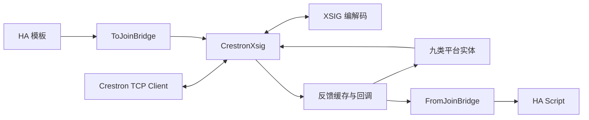

# 技术架构

本文面向 AI 协作者和后续开发者，描述当前代码行为与维护边界。使用说明见 [README.md](README.md)，未完成工作见 [TODO.md](TODO.md)。

## 1. 项目边界与目录

集成采用本地 TCP 推送，HA 作为服务端，Crestron 主控作为客户端。一个 YAML 域对应一个 config entry 和一个活动连接，九个平台共享 hub；不支持按主控配置多个独立实例。`manifest.json` 声明版本 `0.4.0`、`config_flow: true`、`iot_class: local_push`，没有额外运行时安装依赖。

```text
custom_components/crestron/
  __init__.py       YAML 装载、config entry 生命周期、重载、Hub 组合
  config_flow.py    单实例配置项、手动 to_joins 同步入口
  crestron.py       TCP、连接接管、反馈缓存、回调、写入与收发日志
  xsig_protocol.py  纯字节编解码和流式 FrameDecoder
  bridge.py         HA 模板 → join；join → HA Script
  entity.py         平台装载辅助函数和公共实体 mixin
  schema.py         join 编号、join key、整数值校验
  value_coercion.py 通用桥接值转换
  join_commands.py  瞬动、互斥选择、通用成对反馈
  join_registry.py  join 使用关系、冲突检测、日志元数据
  unique_ids.py     各平台唯一标识规则
  device.py         可选设备分组
  locations.py      Excel 位置校验、楼层/区域同步、稳定区域 ID 映射
  diagnostics.py   诊断入口
  light.py / switch.py / cover.py / climate.py
  number.py / select.py / sensor.py / binary_sensor.py / media_player.py
tools/
  xlsx_to_yaml.py   标准库 Excel 解析、校验、设备 YAML 生成
  xlsx_to_automations.py  独立自动化关联生成、注册表匹配、中文报告
  deploy_automations.py   第二阶段 SSH 注册信息读取、备份、部署及重载
  deploy_to_ha.sh   单文件启动器、来源下载/快照、交互参数、两步编排
  deploy_devices.py      第一步设备生成、SSH/SCP 上传、页面、Core 检查及重启
  deploy_common.py       Python 入口复用启动器、SSH 参数、日期备份、HTTP 探测
  list_ha_entities.py    只读实体检索、设备位置解析、彩色中文对齐表格/TSV
  clear_deleted_devices.py 停止 Core、备份并清空已删除设备记录、恢复运行状态
  deploy_dashboards.mjs  JSON 校验、覆盖交互、HA WebSocket 页面部署
tests/             unittest；HA 替身和本地 TCP 测试
dashboard/         受 Git 管理的完整仪表盘 JSON（元信息与 config）
sample.xlsx        四类设备示例
automations_manual_template.yaml  开关双向同步、人在控制的自动化源模板
local/             被 Git 忽略的现场表格及生成配置
```

## 2. 分层与数据流



- `xsig_protocol.py` 不依赖 HA 或 socket；连接层负责向解码器喂字节及写回编码结果。
- `CrestronHub` 位于 `__init__.py`，组合 `CrestronXsig`、两个 bridge 和生命周期钩子。
- 实体持有底层 `CrestronXsig`，同步读取内存缓存，命令通过 `set_*` 下发。
- `schema.py` 直接引用协议范围常量，不依赖连接层。`whole_number()` 用 Decimal 拒绝布尔、小数部分非零和非有限值，供 number 和 climate 共享。

## 3. 配置装载与重载

`configuration.yaml` 的 `crestron:` 域包含必需 `port`、可选 `to_joins` / `from_joins` 及平台列表。YAML 保存于 `hass.data[DOMAIN][YAML_CONF]`，配置项本身不保存实体参数；config flow 通过固定域唯一标识防止重复实例。

启动时导入 YAML 创建 config entry；setup entry 建立 hub、启动监听、转发九个平台。`setup_platform_entities()` 对每条配置分别校验、构造；失败记录 ERROR 并跳过，同平台重复 unique_id 保留先出现的实体。设备关联只在 `device_id` 非空时创建。

各平台仅为校验通过、构造成功且 unique_id 不重复的实体收集位置候选项。等待平台完成设备与实体注册后，批量执行 `async_sync_locations()`；每次 setup 重新收集候选项。位置同步失败会记录异常，保留已经启动的设备控制，修复原因后需重载。不能把集成启动成功视为位置同步成功。

`crestron.reload` 为管理员动作：读取 YAML、检查顶层及平台段结构、替换内存配置并重载配置项。失败后尝试用旧配置再次重载；如果恢复也失败，集成可能保持未运行状态。它不是文件回滚，不改磁盘上的 YAML。

必须区分三个校验层次：

| 层次 | 当前处理 |
|---|---|
| Excel 生成器检测到错误 | 整次生成终止，保留原输出文件 |
| YAML 域/平台段结构错误 | 可能拒绝装载或重载 |
| 单条平台实体无效或 unique_id 重复 | 记录错误，跳过该条，其他实体继续 |

启动对未知域内顶层键只告警，重载则拒绝；移除未知键后可以重载。join 使用冲突以警告提示，不自动改编号或阻止所有装载。UI 普通重载入口与明确重新读取 YAML 的 `crestron.reload` 不应混为一谈。

## 4. XSIG 编解码

| 类型 | 编码 | join 范围 | 值 |
|---|---|---|---|
| 数字 | 2 字节，`10vjjjjj 0jjjjjjj` | 1–4096 | v 为反相电平位 |
| 模拟 | 4 字节，`11vv0jjj 0jjjjjjj 0vvvvvvv 0vvvvvvv` | 1–1024 | 无符号 16 位整数 |
| 串行 | `11001jjj 0jjjjjjj`＋UTF-8＋`0xFF` | 1–1024 | 发送最大 252 字节正文 |

线上 join 从 0 编码，对外 API/YAML 从 1 编号。模拟 16 位值由首字节 2 位及末两字节各 7 位组成。模拟编码会夹到 `0–65535`，业务层应事先验证所需语义，不能依赖底层夹值掩盖非法输入。

FrameDecoder 处理 TCP 拆包、粘包，保留不完整尾部；错误 UTF-8 产生可记录事件并丢弃该帧。未知帧按当前解析规则消费。串行发送超长整帧丢弃，接收端不会按 252 字节拒绝已终止长帧；未终止缓冲超过 65536 字节会报错并结束连接。

控制字节与项目行为：

- HA 新连接发送 `0xFD` 请求同步。
- 主控发送 `0xFB` 时，HA 重新渲染并发送配置中的全部 `to_joins`。
- 不实现单根 join 查询，实体不轮询。

**不要把 `0xFD` 描述成完整数字/模拟/串行快照保证。** Crestron 旧版 Symbol Guide 对 Update Request 的描述是发送非零数字和模拟值、不发送串行值；当前现场 CP4N 程序是否另行补发零值、串行和设备状态，需要抓包验证。参考 [Crestron SIMPL Windows Symbol Guide，第 195 页](https://www.crestron.com/getmedia/39357ef1-4169-4e0f-82c3-d1f0958dcaa5/mg_sw-simpl_symbols_guide_1)。旧资料不直接证明当前现场实现。

## 5. 连接、缓存与可用性

连接时序：

1. `listen(port)` 在 `0.0.0.0` 等待 TCP Client。
2. 如已有 writer，新连接会替换旧连接；关闭等待有超时。
3. 写入 `0xFD` 并 drain，随即设 `available=True`。
4. connect callback 重置数字脚本边沿基线并同步 `to_joins`。
5. 进入 read / decode / 更新缓存 / 分发回调循环。
6. 断开时通知不可用；旧连接退出不能清除已接管的新 writer。

`available` 表示连接可用，不表示初始同步完成。`_digital/_analog/_serial` 只由成功解析的入站帧更新，出站命令不写入这些反馈缓存。`get_*` 可能返回默认零/空串；`has_*` 才表示是否收到过。

缓存不因重连清空；重载创建新 hub 后才重新开始。当前没有每 join 的连接代次或反馈时间戳，不能从有缓存推断当前会话已刷新。

命令直接 `writer.write()`，普通写入没有逐条 drain、确认或离线重放。`batched_writes()` 可以嵌套，在外层退出时统一写入；异常退出也会冲刷已收集数据。未连接时命令丢弃并记录日志。

同步统计在 INFO/DEBUG 启用，记录首帧延迟、帧数、不同 join 数、接收跨度及分发耗时。连续约一秒无新帧仅用于输出统计，不构成“状态已完整”的屏障。

## 6. 桥接与实体更新

### ToJoinBridge

模板优先级为显式 `value_template`、`entity_id`＋`attribute`、实体主状态。通过 HA 模板结果追踪器订阅变化。新连接、`0xFB` 或选项操作触发全部重发；全量同步逐条隔离模板异常。

`value_coercion.py` 为通用转换：数字识别约定的开关文本；模拟按 `int(float(value))` 后限制到协议范围；串行转文本。未知/不可用等无效状态跳过。这里不是 climate/number 的严格整数接口，也不自动将业务量缩放；非有限模拟输入的异常覆盖仍需改进。

### FromJoinBridge

每个 join 对应一个 HA Script，重复键最后一条生效并告警。数字脚本必须观测到严格字符串 `"0" → "1"`，首次值不触发；断线和每次连接接管均清空基线。没有时间防抖。初始低值若不补发，首个高值会被用作基线而跳过。

模拟和串行每帧触发，不做重复值过滤。脚本收到 `value` 变量，通过 HA 后台任务运行，异常隔离，读循环不等待动作结束。脚本任务没有集成层面的集中取消/并发策略，当前共用 Context；实际并发还受 HA Script 行为影响。

### CrestronEntity 与命令辅助函数

公共 mixin 放在平台实体基类之前，提供不轮询、连接可用性、订阅/退订。反馈写状态通过事件循环 `call_soon` 合并：同一批回调对同一实体只排一个待执行写；整个启动过程可能包含多批，因此不能承诺总共只写一次。移除后已排队写操作不会继续写状态。

`pulse_digital()`：在实体锁内置高、等待 0.2 秒、finally 置低。同一实体脉冲串行，不同实体可以并行；断线时 finally 不能保证低值送达硬件。`set_one_clear_others()` 先清除组内其他 join，再置目标为高；该选择信号保持高，不是瞬动。

`paired_feedback()` 供 switch、开关 light、cover 使用，接受一高一低的成对反馈；同高/同低返回不确定。它使用 `get_digital()`，尚无要求两根反馈都已上报的完整性判据。climate 使用自己的命令后反馈记录，避免旧电平参与新命令的确认。

## 7. 平台行为

| 平台 | 控制、反馈与状态策略 |
|---|---|
| 调光 light | 亮度 0–65535 ↔ 0–255；色温原值 K，2700–6500；开灯恢复最近非零亮度，记忆可跨重启；实际亮度和开关显示仍取反馈，未收到亮度时目前显示关/0 |
| 开关 light | 保持电平或成对脉冲；反馈优先 state、switch、成对；支持预显示与历史恢复 |
| switch | 保持电平与脉冲二选一；反馈优先 mode_joins、state、switch、成对；模式组全部上报且全低才确认关闭 |
| cover | stop 必需，pos 或完整 open/close 至少一项；开关优先脉冲，否则写位置；真实位置优先于推定位置 |
| climate | 开关脉冲，模式/风速互斥保持电平；目标温度严格整数；历史恢复与命令预显示，后续按对应通道的新反馈校正 |
| number | min/max/step 为整数；写入/恢复限制范围，实时反馈原样接受，包括 0 |
| select | 非空选项组；先清后置；反馈首个高值生效，全低保留最近选择；支持恢复 |
| sensor | 模拟/divisor 或模式组二选一；未上报返回未知，模式组全已知且全低才显示关闭 |
| binary_sensor | 读取数字 join；未上报未知 |
| media_player | 静音数字量，音量按 65535 缩放，音源原值；0 为关机；显示依赖反馈 |

补充边界：

- 调光灯关机在已缓存亮度大于 0 时，先重发记忆亮度（无记忆时补录当前值）、等待 0.2 秒再置零；这样刚下发的新亮度不会被旧反馈缓存替换。新开灯命令通过序号使旧延迟关灯失效。
- 调光灯的 `_last_brightness` 保存 1–65535 的模拟量原值。显式调光命令先更新记忆，后续该亮度通道的非零反馈再按真实值校正；零值、色温和连接状态反馈不修改记忆。普通开灯仅在反馈为关时下发记忆值，没有记录才用 65535；已开灯时不重设亮度。实际 `brightness`/`is_on` 仍直接读取反馈缓存，记忆值不代表命令已经执行。
- `CrestronLight` 继承 `RestoreEntity`，通过额外状态属性 `last_nonzero_brightness` 保存原始亮度；关灯时该属性仍存在。加载时校验历史值为 1–65535 的整数；首次升级可从旧开灯状态的标准 `brightness`（1–255）换算。已知、在线的非零缓存优先于历史记忆，等待恢复期间收到的新反馈或命令也优先；恢复本身不发送开灯命令。[HA 2026.10.0 RestoreEntity](https://github.com/home-assistant/core/blob/2026.10.0/homeassistant/helpers/restore_state.py) 在内部生命周期注册实体，正常关闭和周期性保存状态；此方案支持正常重启/重载，不保证异常断电前尚未落盘的最新值。
- 色温 join 必须配合亮度；不允许模拟灯光与数字开关控制混用。light 的 `type` 标签不替代 join 能力检查。
- cover 的 `current_cover_position` 优先真实位置，但 `is_closed` 另行优先独立关闭反馈、成对反馈，再参考位置；冲突时两属性可能不一致。
- number 的 step 是 UI 元数据，整数与范围校验不检查 `(value-min)` 必须为 step 的倍数；min/max 尚未受无符号 16 位边界约束。
- media_player 音源映射校验正整数、归一化编号冲突和重名，尚未限制编号最大 65535。

### 空调数值与反馈路径

空调固定使用摄氏度，目标步长 1、范围 16–30。`async_set_temperature()` 先调用共享整数校验并检查范围，通过后才更新目标值与发送模拟值；没有设温参数或没有 set_temp_join 时不操作。历史目标温度也经同一校验。

初次加入实体时，用 `has_analog/has_digital` 判定 hub 已有的反馈；目标温度反馈不按命令范围裁剪，真实 0 仍有效。运行期间按回调通道分开处理，温度事件不校正模式，风速事件不校正目标温度。室温仅在初始装载或自身通道事件中调用 `_reconcile_room_temp()`，差值至少 0.5°C 才接受。

climate 的 `_feedback_levels` 只记录本实体采用的数字反馈。开关、模式、风速命令下发前，分别清除对应组的旧记录，后续只纳入新收到的帧；不会改写共享 hub 的真实收包缓存。组内恰好一个高电平才有明确选项，全低或多个高时保留最近状态。未上报的成员不会阻止已收到的唯一高值生效，因此这仍不是全组同步完成屏障。

开关命令保留 2 秒保护期；到期定时器仅检查这次命令之后实际收到的开关电平，无需等温度或其他事件。无新反馈时保留预显示值。新开关命令会取消旧定时器并清除前次命令的反馈；断线清空本实体数字反馈记录并取消定时器，移除实体也取消定时器。重连可用性通知只更新可用性，不重新导入旧缓存；新上报状态仍正常采用。

`_command_lock` 是每台空调独有的锁，覆盖开关、模式、风速和设温的完整操作；模式命令的开机脉冲与后续模式写入在同一锁内完成。例如从关闭状态先请求制冷、随即请求制热，线上顺序为开机脉冲、制冷、制热，不再发生旧制冷延迟到新制热之后发送。关机及其他操作同样排队，不同空调仍并行；批量限速不属于这把锁的职责。脉冲取消时仍在 finally 释放电平；移除实体后，排队操作和未发送的后续模式命令丢弃。

模式/风速继续使用互斥保持电平，没有改成点动协议，也没有自动重发失败命令。新的矛盾反馈（例如制热后又收到明确制冷、设温后又收到不同目标温度）仍会反映到 HA，不能用预显示掩盖主控侧回退。climate DEBUG 日志记录带设备名的命令和字段反馈变化，用于与 XSIG 帧日志交叉核对。

## 8. 身份与设备分组

唯一标识集中在 `unique_ids.py`。已定规则不自动迁移；位置同步读取 HA 实体注册表确认归属，仅清除所管理实体的区域覆盖，不改写 entity_id、unique_id、自定义名称，也不清理注册表。修改显示名不会改变标识，修改用于身份的 join 会改变标识。

| 平台 | unique_id |
|---|---|
| 调光 light | `crestron_light_<brightness_join>` |
| 开关 light | `crestron_light_onoff_d<switch_join 或 on_join>` |
| switch | `crestron_switch_d<switch_join 或 on_join>` |
| cover | `crestron_cover_d<open_join>`，仅位置时为 `crestron_cover_<pos_join>` |
| climate | `crestron_climate_d<on_join>` |
| number | `crestron_number_<value_join>` |
| select | `crestron_select_<完整选项 join 升序以 _ 拼接>` |
| 数值 sensor | `crestron_sensor_<value_join>` |
| 模式 sensor | `crestron_sensor_mode_<完整模式 join 升序以 _ 拼接>` |
| binary_sensor | `crestron_binary_sensor_<is_on_join>` |
| media_player | `crestron_media_<source_number_join>` |

开关灯实现还保留 state_join 的防御性身份兜底，但正常配置必须有控制能力。旧 `entity.join_uid()` 已无生产调用，不应继续用于新增实体。

### 楼层、区域与设备名称

生成的设备元数据为 `device_id`、`device_name`、`floor`、`room`；`name` 和 `device_name` 使用 Excel 名称去重后的结果。设备 identifier 仍为 `(DOMAIN, device_id)`，不依赖显示名或位置。HA 的用户自定义设备名、实体名保持优先，不强制覆盖。

- 两个位置字段均缺省时兼容旧配置，继续使用 `suggested_area`。出现任一个字段时，`floor`、`room`、`device_id`、`name` 都必须是非空字符串；通用装载和 reload 预检使用同一校验函数。
- 有明确位置的 DeviceInfo 不提交 `suggested_area`，避免平台注册阶段提前创建不完整区域。注册完成后按 `(platform, DOMAIN, unique_id)` 找实体，再确认 config entry 和设备 identifier；未注册、其他集成或同设备位置冲突的条目不参与同步。
- 楼层按名称复用或创建。名称匹配采用 HA 的 `casefold().replace(" ", "")` 规则；位置键为规范化 `[floor, room]` 的 JSON 字符串，避免点号拼接歧义。楼层只设置名称，不推断高度或层级数值。
- HA Store 版本为 1，键为 `crestron_locations.<entry_id>`，内容为 `{"areas": {位置键: area_id}}`。优先恢复已保存且楼层匹配或尚未分配楼层的区域；其次复用目标楼层的原房间名、旧 `楼层.房间` 名，再检查未分楼层的旧名、原名。不抢占属于其他楼层的区域。
- 同一楼层/房间共用一个区域。不同位置同名时，所有参与重名的房间从 1 编号；先保留原始带数字房间名和未参与导入区域的名字，跳过冲突后缀。首次按位置键排序分配，后续尽量保留已分配后缀及区域 ID，不因表格行序调整交换房间。
- 区域更名先使用临时唯一名释放旧名，再统一设置最终名和 floor_id，避免名称互换冲突。注册表批次内不 await。映射变化时先保存 Store，再修改设备 area_id；清除对应实体的显式 area_id，使其继承设备位置。
- YAML 位置是这批设备的分区依据，重载会重新应用。无引用的设备、楼层、区域以及历史映射不会自动删除。仅有一个房间名称时可以恢复原名，区域 ID 保持稳定。

位置操作使用 HA 公开注册表接口，不直接写 `.storage`，不发送设备控制命令。已核对 [HA 2026.8.3 平台生命周期](https://github.com/home-assistant/core/blob/2026.8.3/homeassistant/helpers/entity_platform.py)：平台 setup 等待实体添加任务结束后返回，位置同步因此放在 `async_forward_entry_setups()` 之后。真实 HA 端到端验证仍待完成。

注册表与 Store 没有跨对象事务；异常可能留下部分楼层、区域或临时名称，日志会报告同步失败。需核对后重载，不能保证自动完整回滚；映射文件应随 HA 配置一同备份，丢失后不能保证复用已编号的房间。

## 9. Excel 转换流程

`parse_xlsx()` 用 ZIP/XML 读取工作簿关系、共享字符串和 inline string。第一条工作表行作为表头，按单元格引用定位列；按 `<row r="…">` 保留真实行号。缺少可选 r 属性时使用前一行号加一，行数据保留内部 `_xlsx_row` 供诊断。

流程为：表头检查 → 模板/空行识别 → 单元格和能力组合校验 → 四类 builder → 名称去重及 join 检查 → 分平台 YAML 输出。编号列按范围验证，序号列不决定诊断行号；列名拼错、重复列名及缺少必需列有各自诊断。

四个设备 sheet 都要求“楼层、房间、名称”表头及设备行非空值；空调模板已补“名称”，不再自动拼接“楼层.房间 空调”。按规范化楼层/房间分组，跨所有平台统计名称（名称忽略大小写）；同房间重名全部编号为名称1、名称2，原始唯一名称优先占位，后缀避开冲突。设备身份仍由原 join 规则生成。输出原始 floor/room，房间全局重名交给运行期注册表处理，便于考虑 HA 已有区域。

`sample.xlsx` 同时作为双方接口对照与 HA 生成示例，保留原有 8 台设备的 join/身份。灯光、插座含两个关联列，空调只含关联开关列，窗帘无关联列；虚构控制源统一以 `switch.example_` / `binary_sensor.example_` 开头，涵盖单个、多行、共用和留空。说明页解释 TCP/XSIG 方向、脉冲与保持电平、编号和运行值的区别，以及分两步生成流程；该页不参与转换。设备页冻结表头及前四列，关联字段绿色表头、多行单元格自动换行。样表更新须同时通过设备和关联格式检查；示例实体不应直接匹配现场注册表。

builder 单独调用时可能返回 None；用户入口先汇总错误，存在任何错误便抛出 WorkbookValidationError，不创建目录/写目标文件。成功则覆盖全文件，输出默认 port 10200 和设备列表，不合并旧内容。`--check` 不写文件，通过返回 0，校验失败返回 1。

转换器及部署工具的自有提示、代码注释和帮助使用简体中文，保留配置键、命令参数和协议标识。转换报告以“信息/警告/错误”分级，使用“工作表名＋表第N行”标明真实行号；相同报告写入终端和 YAML 注释。参数解析的帮助标题及常见错误已中文化；第三方命令、系统异常和 HA 返回的原始错误保留原文，便于诊断。风速值提示说明改用数字档位编号，档位列全部为空时补充未配置风速调节。

生成器只有四个设备 sheet，不生成其他五个平台或桥接脚本；特殊风速值列有意忽略。YAML 序列化器自行处理标量引用和转义，不依赖 PyYAML。PyYAML 可用于额外回读测试。

### 自动化生成与模板接口

设备与自动化分两阶段：`xlsx_to_yaml.py` 只生成设备配置，认识两列关联表头但不输出关联；`xlsx_to_automations.py` 复用其 Excel 解析、设备校验及名称去重，单独生成自动化。灯光/插座支持开关和人在关联，空调仅开关；窗帘不支持。拆分实际换行和字面 `\n`，去空白、去重，按控制端聚合多对多映射；非法实体域、已填关联的无效设备行均报真实 Excel 行号。无关联时生成空触发器自动化，报告明确说明覆盖会移除旧关联。

注册表输入为 JSON 对象：`entities` 必需，`devices`、`areas`、`floors` 可选；部署读取时四类齐备，并附加当前 `states`。实体按 `(platform=crestron, entity_id域, unique_id)` 匹配，不按名称猜测；唯一标识规则与集成有契约测试。Excel 或 HA 中相关唯一标识重复、禁用实体均拒绝；关联开关/传感器可来自任意品牌。`states` 存在时还要求实体已经加载；没有注册记录但存在实时状态的控制源可用。控制源和被控目标集合不能重叠，避免双向反馈循环。独立生成支持只有注册表的离线快照；此时不能保证当前实体已加载。

报告逐条输出 Excel 行号、被控设备的 Excel 楼层/房间/名称和 entity_id，以及控制端 HA 楼层/区域/名称和 entity_id，再汇总组规则和数量。控制端位置优先实体 area_id、其次设备 area_id，通过区域 floor_id 关联楼层；storage 楼层键是 floor_id，导出时规范为 id，读取兼容两者。名称优先用户名称/实时友好名，再回退注册名和设备名；缺失位置明确标注。相同报告写入输出 YAML 顶部注释，换行折叠防止注释注入。

根目录模板保存单条自动化结构、品牌无关的控制逻辑及手工填写示例。生成器仅用标准库做文本替换和简单 YAML 序列化（字符串全部引用），不执行 HA Jinja。默认成品 `automations_manual.yaml`；禁止覆盖输入、模板和设备配置，校验成功后在输出目录临时写入再原子替换，失败保留旧文件。`--check` 只检查并输出关联清单；`--check-xlsx` 在第一阶段上传前检查工作簿和模板，不要求 HA 注册表。

三个独立标记 `@@TRIGGERS@@`、`@@SWITCH_MAP@@`、`@@OCCUPANCY_MAP@@` 各占一行且仅出现一次。生成器替换整行，将序列化内容每一行加上原标记行的基础缩进（触发器 2 空格，映射 8 空格），不得对整个文件做 Jinja 渲染。空触发器用 `[]`，空映射用 `{}`；检查没有残留标记。模板中原有 `{{ ... }}`、`` 留给 HA 运行时求值。

映射接口：

| 区域 | 键 | 值 |
|---|---|---|
| `switch_map` | 控制端 `switch.*` 实体 ID | `light_entity_ids`、`switch_entity_ids`（被控插座）、`climate_entity_ids` 三种列表 |
| `occupancy_map` | `binary_sensor.*` 实体 ID | `light_entity_ids`、`switch_entity_ids` 两种列表，不控制空调 |

列表缺省按空处理，生成时须去重。所有被控目标使用真实 HA 实体 ID，不沿用手工文件的 `light_device_ids`；仅凭设备名称或 join 不能假定其当前 entity_id。控制开关与被控插座均属于 switch 域，生成器必须校验角色，拒绝自关联及控制循环。反向映射由运行时遍历同一映射表得到。

生成触发器的固定契约：`switch_changed` 监听 switch_map 的键；`crestron_changed` 监听其所有被控灯、插座和空调的并集；两者使用 state 触发和 `to: null`，忽略属性变化。`occupancy_on` 监听 occupancy_map 的键，`to: "on"`；`occupancy_off` 监听同一批传感器，`to: "off"`、`for: "00:00:30"`。没有对应实体时省略该触发器，不提交空 entity_id 列表。无关联时生成空触发器与空映射，不增加启动同步。

运行规则：灯/插座的 `on` 算开启，空调的 heat/cool/heat_cool/auto/dry/fan_only 算开启，`off` 算关闭；不使用 hvac_action 判断，空调待机仍为开启。任意开启便回写关联开关 on；所有目标明确 off 才回写 off，否则不回写。缺失、unknown、unavailable 不视为关闭。反馈分支使用执行时当前状态，恢复可用的状态变化也可重新对齐。

正向分支只接受控制开关的 on/off 互转，并跳过执行时状态已与事件不符的旧事件。组内已有设备开启时，ON 不再群发，避免反向回写连带开其他设备；主动操作恰遇短暂失同步也受此限制。OFF 在组未全关时按灯、插座、空调顺序发出关机服务，全部命令发出后最多等 8 秒反馈；服务错误记录后继续其他类型。只使用各域 turn_on/off，不发模式、亮度、温度或风速设置。

人在分支按受影响的每个灯/插座反查所有关联传感器，在每个动作前检查当前值。有人事件仅在仍有至少一个传感器 on 时开；无人事件要求每个传感器存在、明确 off 且 `now() - last_changed >= 30秒`，才关该设备。最后变为 off 的传感器在满 30 秒时产生的触发负责最终关机，无需把 30 秒延迟放进执行队列。重新有人、unknown/unavailable、重新变为 off 尚不足 30 秒时跳过旧关机事件。

整条自动化使用 `mode: queued`、`max: 100`，关机反馈等待可能拖延其他区域；慢反馈、超时与相反操作仍可能竞争，服务执行前检查也不是事务。没有手动保持、持久化同步锁、重试或启动对齐。关联开关必须支持实际远程写状态；HA 重启/重载会丢失尚未完成的触发器 `for` 计时。框架语义参考 [HA 触发器](https://www.home-assistant.io/docs/automation/trigger/) 与 [脚本动作](https://www.home-assistant.io/docs/scripts/)。

`tests/test_automation_template.py` 使用测试映射替换三个区域，通过 PyYAML 解析和沙箱 Jinja 执行真实动作分支，使用状态/服务/时钟替身验证混合组、双向回写、多传感器、未知状态和旧事件。它不验证 HA 的完整 schema、调度器或真实设备反馈；仍需真实 HA 校验及现场验证。

## 10. 诊断与运维

诊断顶层包含 `configured_entities`、`to_joins`、`from_joins`、`join_usage`、`xsig`。其中 `xsig` 包含 `available`、`connected`、脱敏 `peer`、`listening_port`、`cache_counts` 及三类缓存。串行值输出字符长度占位，数字/模拟值保留。配置计数不是实际注册实体计数。

`join_registry` 为读写关系生成元数据，发现重复写入、桥接冲突；只读镜像允许共享。帧日志独立使用 `custom_components.crestron.crestron.frames`，用于把原始 join 对应回实体/字段。

### 只读实体检索

`tools/list_ha_entities.py` 接受多个位置参数，对 entity_id 做不区分大小写的字面子串 OR 匹配；未提供关键词或交互回车时默认 `_occupancy_status_p_`、`_oh4w_on_p_`，单独的 `*` 表示全部。通过 `deploy_common.Connection` 建立 SSH，复用 `deploy_automations.Api/read_registry` 读取实体、设备、区域、楼层注册信息及实时状态，两者按 entity_id 合并去重，因此保留停用/未加载实体并补充无注册记录的当前实体。仅认证和读取，无设备服务调用、文件上传、备份或重启。

设备名优先 name_by_user，其次 name；实体名优先实体注册表自定义 name，其次实时 friendly_name，再回退 original_name（has_entity_name 时附设备名）。位置优先 entity.area_id，再 device.area_id，通过 area.floor_id 查楼层。无位置标注“未分配”，无关联设备标注“无关联设备”，保留悬空 device_id 以便排查；输出 device_id 是 HA 注册表 ID，不是 Crestron YAML 中的 light_2 等分组标识。结果按楼层、房间、设备名、实体名、ID 排序。

实体名称显示前移除其中与最终设备名称完全相同的字面文本，并清理首尾空白及常见分隔符；结果为空显示 `—`。没有匹配则原样保留。不修改原始快照、设备名或 ID，表格和 TSV 使用同一份简化后的实体名称。

无参数交互使用 getpass 隐藏密码，空密码选 key；--identity 展开 ~，未指定时不附 -i/-F、不枚举密钥，交由 OpenSSH 的默认密钥、~/.ssh/config 和 agent 处理。默认用户 root、端口 22；本工具不继承 HA_SSH_PASSWORD，作用域内设置密码环境供公共连接和 API 子进程使用，退出时恢复。--password 的值不会拼入 SSH 子命令或查询日志，但原 CLI 参数可能进入用户 shell 历史。

连接参数只问一次，交互查询循环每轮重新 fetch_snapshot，更新关键词后重新读取数据；单轮连接/查询错误会报告并允许输入下一次查询。带参数调用执行一次后退出。Ctrl+C（包括 less 浏览期间）或 EOF 退出，返回 130，不捕获中断后继续查询。

表格先按 Unicode W/F 两列、Mn/Me 零列计算宽度再添加 ANSI 颜色，支持普通中文和组合字符；复杂 emoji 的宽度仍取决于终端。六列按最长内容补齐，完整 ID 不截断，每条实体只生成一行。show_results 对 TTY 表格检查终端尺寸，超宽或超高时将完整结果经标准输入交给 `less -S -R -K`，禁止软折行、保留颜色、Ctrl+C 退出。每轮重新检测尺寸；q 关闭查看器回到查询循环。清空 LESS 避免用户的自动退出/折行设置干扰，禁用 LESSOPEN/LESSCLOSE，设置 LESSSECURE 和 UTF-8 字符集；不使用 shell 执行分页命令。缺 less 明确报错，不退回会错位折行的直接输出。重定向/TSV 不启动 less，保持完整可导出内容。

名称控制字符转为可见转义，避免破坏行结构；关键词高亮前做 re.escape。auto 颜色仅 TTY 且 TERM 非 dumb、无 NO_COLOR 时开启；always/never 显式覆盖。--format tsv 始终无颜色，带参数时标准输出只含结果，进度及错误写标准错误。依赖 Python 标准库及同目录工具，服务器需 jq/curl/ha；缺认证或读取失败时整轮报错，不假装返回完整列表。

`tests/test_list_ha_entities.py` 覆盖 OR/字面匹配、实时与注册实体合并、位置覆盖/继承、缺关联、名称优先级、中文/长 ID/颜色对齐、控制字符、TSV、密码不进入 SSH 参数、默认密钥规则、交互/EOF 和只读调用边界。已完成目标 HA 的只读查询验证；未部署、重启或控制设备。

新增回归覆盖默认关键词、显式全部、重复设备名称移除、连续刷新和失败重试、分页参数及环境、完整 ID 与六列宽度、Ctrl+C 退出、缺少查看器和重定向不分页。本机具备 less/POSIX 时使用真实伪终端验证 q/Ctrl+C 及终端恢复；查询工具 21 项测试通过，复用公共解析/凭据函数的清理工具 17 项回归通过。

### 已删除设备记录清理

`tools/clear_deleted_devices.py` 通过公共 SSH 连接执行远端 POSIX shell，只处理 `/homeassistant/.storage/core.device_registry` 的 `data.deleted_devices`。复用实体查询工具的中文参数解析、密码环境隔离和颜色开关，无参数交互输入；`--dry-run` 仅查询数量和状态，默认写入前确认，`--yes` 显式跳过确认。空列表或字段不存在直接退出，不停止 Core；字段存在但不是数组则拒绝。

停止状态不能从 HTTP 失败判断：当前现场 `ha core info` 没有 Core 状态字段，Supervisor 自身的 state 也不能代替。脚本使用 `ha core stats --raw-json`：成功的对象响应表示运行中；只有明确的 `Home Assistant is not running` 或 `homeassistant_not_running_error` 表示停止。依据 [Supervisor 2026.09.3 Core 实现](https://github.com/home-assistant/supervisor/blob/2026.09.3/supervisor/homeassistant/core.py) 和 [对应异常定义](https://github.com/home-assistant/supervisor/blob/2026.09.3/supervisor/exceptions.py)。查询超时、非 JSON、其他 API 错误一律拒绝修改。stats 限时 30 秒，stop/start 各 180 秒。

确认后在同一远端进程内创建排他锁目录 `.crestron-device-cleanup.lock`，复查 Core 状态及已删除集合 SHA-256，再停止 Core。停止落盘后重新确认集合未变化；变化则退出、恢复原运行状态，要求重新预览。完整文件备份到服务器日期目录 `device-registry/core.device_registry`，核对 SHA-256 后才生成新文件。原文件复制到 `.storage` 同一文件系统的临时目录，保留权限/所有者，用 jq 清空目标数组，并比较整个 JSON 确认其他内容不变；复查停止状态和原文件哈希，再原子替换及回读校验。拒绝注册表符号链接。

EXIT/HUP/INT/TERM 处理在远端执行：校验失败且确认 Core 仍停止、文件仍是本次写入版本时恢复完整备份；有第三方变更或无法确认停止时不盲目覆盖，也不自动启动。写入提交成功后，启动失败保留清理结果和备份并报错。原本运行则恢复启动并通过 SSH 等待 HTTP 200/401；原本停止则保持停止。正常退出清理暂存目录及锁，备份保留。排他锁只约束本脚本，不能阻止外部管理员操作；SSH 断线、SIGKILL、断电仍可能留下锁或停止状态，需人工核查。

`tests/test_clear_deleted_devices.py` 在本机临时目录运行真实 shell/jq/文件操作，替换 HA 命令，覆盖正常清理、原本停止、空集合、停止失败/未停止、状态未知、备份失败、写后校验失败回滚、第三方修改、启动失败、确认后集合变化、锁冲突及符号链接；CLI 测试覆盖只读预览、取消、交互凭据和恢复等待边界。目标 HA 只运行过 `--dry-run`；正式停机清理尚未验证。

### GitHub / 本地安装与更新

`deploy_to_ha.sh` 由本地 Bash 编排，`--install` 为默认模式，`--update` 要求远端组件已有 manifest，默认不上传设备 YAML；设备生成和自动化生成独立询问，回车/EOF 都为否，显式参数覆盖交互。来源默认 local，显式 --source local 与 --branch 互斥；仅指定 --branch 隐含 github，GitHub 默认分支 master，不读取本地 Git 分支。

无参数先显示“1. 本地目录（默认）、2. GitHub”，本地根目录由脚本位置 tools/.. 推断，再询问连接参数。入口可单独下载，无须相邻 Python 文件：不存在本地项目 manifest 时，交互运行直接列 GitHub 分支；带参数且未指定来源/分支时转为 github/master，显式 local 缺源码则报错。独立启动的持久输入/输出目录为 Shell 所在目录/local，而不是脚本上一级或临时源码目录。选 GitHub 时调用 `/repos/<owner>/<repo>/branches?per_page=100&page=N`，逐页读到少于 100 项，显示全部分支供编号选择；有 master 时默认 master，否则第一项。空列表、请求/解析失败或输入结束时停止，不静默选择其他来源。显式命令行模式不读取分支列表。

GitHub 来源通过 curl 调用 GitHub Git refs API，将分支解析为 40 位提交 SHA，再从 codeload 下载该 SHA 的完整 tar.gz，防止部署期间分支变化造成文件版本混用。Python 校验 ref、压缩包单一根目录和必要文件，只提取普通文件与目录，拒绝越界路径、链接和特殊文件；下载/校验失败时尚未访问 HA。

本地来源以 `SCRIPT_DIR/..` 为项目根，不要求 Git 仓库，不使用调用者的工作目录；校验必需文件后，以 Python 递归复制当前目录内容到临时快照，因此包含未提交修改和新增文件。按名称排除 `.git`、`local`、`__pycache__`、`.mypy_cache`、`.pytest_cache`、`.ruff_cache`、`.venv`、`venv`、`node_modules`、`.env`、`.env.*`、`crestron.yaml` 和 `.pyc/.pyo` 文件，不解释 `.gitignore`；未排除的链接和特殊文件直接拒绝。临时目录即使位于项目内也不复制自身。副本完成后使用该副本部署；复制期间应避免同时修改源码，复制不是文件系统原子快照。本地快照编号为 UTC 时间加随机 UUID 片段，不伪装成 Git 提交。

组件、Excel 转换器、两个 Python 部署工具、deploy_common.py、自动化模板及页面工具均指向所选源码的临时副本。Shell 自身只负责源码准备、交互及调用两步工具，不再次执行下载的同名脚本；缺失公共模块或所需步骤工具时在连接 HA 前报错，不回退本地代码。项目模式中，用户 Excel、生成 YAML 仍定位到项目 `local/`；页面备份通过 SSH 写入 HA 服务器；`--dashboard-dir` 可显式使用本地页面。全部模式均需 curl/Python，页面模式另需 Node 22+。源码不存在 dashboard 时，完整部署提示跳过；仅页面模式报错。

完整部署顺序：下载 GitHub 源码或复制本地源码并校验 → 校验页面及远端备份参数支持 → 按选项生成/检查本地 YAML → SSH 连接与更新前置检查 → 确定恢复探测地址并检查远端 curl → 创建服务器日期备份目录 → 压缩并校验旧组件备份 → 上传清除 crestron.yaml/pyc 缓存后的组件与可选设备 YAML → `ha core check` → `ha core restart` → HTTP API 恢复探测 → 等待实体加载、动态生成页面 → 页面备份与部署 → 可选自动化第二阶段。不上传整份源码、工具、文档、测试或示例配置，不创建新的 `crestron-source` 存档。下载、解压、组件副本和阶段结果只放本机 `STAGE_ROOT`，通过 EXIT trap 清理，INT/TERM 转为退出；强制杀死进程或断电仍可能留下本机临时目录。

组件使用传统 SCP（`-O`），上传具名的 `crestron` 目录至组件父目录，不使用被 SCP 拒绝的 `目录/.`。远端仅保留正式运行文件和备份。`deploy_common.create_backup()` 使用服务器 `date` 一次取出日期和时间，以 `mktemp -d` 创建 `/homeassistant/crestron-backups/YYYY-MM-DD/HHMMSS-随机编号/`，同一次部署只创建一次，权限受 `umask 077` 保护，并校验返回路径后再拼入后续命令。

组件备份用服务器 tar/gzip 将整个旧 `crestron` 目录（包含现场 YAML）直接压缩到 `crestron.tar.gz.part`，`tar -tzf` 成功后改名为 `crestron.tar.gz`，无需另存解压副本。失败时 trap 清理未完成压缩包，停止覆盖组件。首次安装没有旧组件时不产生压缩包。页面备份与组件备份共用本次部署目录；仅页面模式单独创建日期目录。所有已完成备份保留，不自动清理历史源码存档、旧备份或迁移旧备份。

只重启 Core 服务，不执行主机重启。使用 `ha core info --raw-json` 的端口/SSL 和 SSH 目标主机，或 HA_URL/`--ha-url` 得到 `/api/` 地址。上传前确认远端有 curl；重启后通过 SSH 在服务器端执行 curl，不使用部署电脑的 HTTP 代理。自定义 URL 必须能从服务器访问；用 Python `shlex.quote` 引用 URL，兼容远端 POSIX shell，保留 TLS 证书验证。每轮 curl 限时 5 秒、间隔 2 秒，SSH 沿用连接超时并设置 `ServerAliveInterval=5`、`ServerAliveCountMax=1`。只有 SSH/curl 退出码为 0 且 HTTP 为 200/401 才视为恢复。显示地址、等待时长、状态和失败详情；默认等待 120 秒，`--restart-timeout` 可调，实际退出可能多一个包含 SSH 连接的探测周期。该检查不证明 HA 完全启动、Crestron 连接成功或实体可用。

失败会阻止后续步骤；组件配置检查失败不重启，页面运行时生成/部署失败发生在 Core 重启之后，组件已生效，但不会进入自动化第二阶段。组件采用覆盖复制，不清理上游已删除文件。已有组件备份与页面逐项备份，但没有跨组件/页面事务或自动回滚；历史源码存档与备份目录也不自动清理。`--dashboard-only` 准备源码后提前分支，只备份和部署页面，不生成/上传 YAML 或检查/重启 Core；`--skip-dashboard` 不要求 Node.js。

安装与更新统一由 `deploy_to_ha.sh` 编排。`--devices-only` 只执行第一步，`--automations-only` 只执行第二步；两者互斥。两个 Python 公开入口调用 `deploy_common.launch()`，携带对应步骤选项进入相邻 Shell，以复用完全相同的源码准备和交互；Shell 随后用内部 `--prepared` 参数调用所选源码的工具，避免重复下载或递归。独立 Python 运行需要完整项目；单文件安装只需 Shell。

`deploy_devices.py` 负责页面预检、设备生成、SSH 检查、组件日期压缩备份、SCP、Core 检查/重启及 HTTP 等待。第一步成功后在 STAGE_ROOT 写 device-result.json，仅含 backup_dir、ha_url；自动化工具通过内部 --context 读取，复用同次备份和探测地址。文件不含凭据，第一步失败不会调用第二步。`deploy_common.py` 管理 SSH/SCP 参数、环境密码、服务器日期目录和 HTTP 探测；源码下载集中在 Shell，两个公开入口均复用它。HA_SSH_PASSWORD / SSHPASS 仅经环境传递，阶段结果不记录密码；显式 --key 清除环境密码。第一步组件副本也放在 STAGE_ROOT 内，随入口退出清理。

运行环境要求以目标 HA 版本为准；转换器的独立 Python 要求不能替代 HA Core 的 Python 要求。

### 第二阶段自动化部署

`python3 tools/deploy_automations.py` 为独立公开入口，与 Shell 支持相同的 --source、--branch、--host、--user、--key、--xlsx 等参数。原 `-- ...SSH命令` 底层接口保留，便于离线注册表导出。`--generate-automations` 启用第二阶段；`--automations-only` 独立执行它，跳过组件/设备上传、仪表盘和 Core 重启。`--automation-yaml` 指定本地成品路径，默认在设备 YAML 同目录；`--upload-automations` 是明确覆盖授权，默认生成后询问（EOF/回车不上传），`--skip-upload-automations` 仅生成。所选源码必须包含生成器、辅助部署工具和模板，缺失时第一阶段写入前停止；不会混用另一分支工具。

第二阶段通过 SSH 只读四类 .storage 注册表，并经 HA REST 读取实时状态；新实体缺失/未加载时每 5 秒重读，最多等 restart-timeout，逐次输出缺失项。无效配置和禁用实体直接停止。HTTP 请求在远端 curl 执行，不经过本机代理。认证优先管理员 HA_TOKEN，否则复用有效所有者浏览器 refresh_token 换取临时令牌，沿用仪表盘认证方式；curl 配置、令牌与请求内容走 SSH 标准输入，仅存内存。没有依赖 SSH 附加组件的 Supervisor Core API 权限。读取成功和注册完成不等于主控反馈完整，unavailable 实体仍可被引用。

生成并展示报告后询问上传。目标为 `/homeassistant/automations_manual.yaml`；保留现有 `automation manual: !include automations_manual.yaml`，缺失则追加独立引用，复杂或冲突的引用停止并要求手工整理，不重写整份主配置。固定自动化 id 为 `crestron_manual_associations`，重载后按该 id 确认实体正常加载；保留 HA 记录的启停状态，不通过自动化部署发送设备控制命令。重载启用自动化后，后续真实事件可能按新规则控制设备。

独立第二步在用户确认上传后才创建日期备份目录；完整流程复用第一步目录。写入前后使用原文件 SHA256 复核并拒绝符号链接，先备份 configuration.yaml 和旧 automations_manual.yaml 到本次日期目录的 `automation/`（首次用 manual-was-absent 标记不存在），再将本地生成的固定文件名压缩包经 SSH 标准输入发送到服务器临时目录。替换、`ha core check` 成功后删除临时目录；正常异常退出/检查失败恢复第二步原文件，备份保留，强制杀死进程不保证恢复。通过普通 HA API 调用 automation.reload，无需第二次 Core 重启；重载失败明确报告“文件已上传但重载未确认”，保留备份，不盲目重复请求。脚本确认完成后回读实时状态检查自动化实体。第一阶段不受第二阶段回滚影响；跨阶段无事务，校验期间仍存在外部并发修改窗口。

`tests/test_xlsx_to_automations.py` 覆盖真实工作簿、品牌无关映射、注册表身份、楼层字段、缺失/禁用/重复、文本安全和输出保护；`tests/test_deploy_automations.py` 在本机执行实际远端写入 shell，覆盖备份、首次安装、检查失败恢复、并发修改和清理，另测试凭据仅经标准输入。部署回归使用真实两个步骤入口及本地替身，覆盖单文件 Shell 下载后部署、默认本地/独立 Python 两种来源、缺工具时连接前停止、两步顺序、仅关联模式、第一步失败阻止第二步、备份共享和失败传播。现场 Excel 与只读注册表的 `--check` 已通过，尚未部署或验证真实联动。

### 空调仪表盘

`dashboard/dashboard-climate.json` 只保存通用模板：`dashboard` 为页面元信息，`config` 含单个空 sections 视图，`generator: {type: "climate", card: {...}}` 定义卡片样式。静态 JSON 仍可只包含 dashboard/config。模板禁止写死 card.entity、name 和 icon_tap_action，部署时统一生成。

`climateSnapshot()` 通过 WebSocket 的 `get_config` 等待 RUNNING，拒绝安全/恢复模式，再读取实体、设备、区域、楼层注册表及 `get_states`。未停用且未隐藏的已注册空调缺少状态时继续等待，默认 120 秒，可经部署参数 `--restart-timeout`（Node 内部 `--wait-seconds`）调整；接口错误立即失败。启动状态字段见 [HA Config.as_dict](https://github.com/home-assistant/core/blob/dev/homeassistant/core_config.py)。状态 unavailable 仍保留卡片，不要求主控在线；零可见空调时报错，避免空配置覆盖旧页面。HA 尚未配置 Crestron 时需先完成集成配置，或暂用 --skip-dashboard。

`buildClimateDashboard()` 为目标 HA 所有品牌可见 climate 实体生成卡片，包含无注册记录但有实时状态的实体。实体区域优先于设备区域，区域关联楼层；缺失位置进入未分配分组。按楼层 level、名称、房间和实体排序，用楼层 ID 分组，避免同名楼层混合。名称采用实体自定义名称/友好名称等并补房间前缀，已有房间名不重复添加。现场数据只在内存生成，不保存到源码或本地持久文件。

每卡 6 列、3 行，同分区每排两张。电源图标调用 `climate.toggle`，正文打开 `more-info`，温度与风速 feature 根据实体支持能力显示，风速档位取实际 fan_modes；保持 bottom 布局以显示两个控件。生成过程中不调用设备服务；页面没有模式快捷按钮。HA 内置 `/climate` 不是本工具管理的 storage 仪表盘。

`deploy_dashboards.mjs` 使用 Node.js 22+ 内置 fetch/WebSocket，无第三方依赖。所有 JSON 文件在连接前做结构与重复 url_path 检查，不包含完整前端卡片 schema 校验。认证优先用 HA_TOKEN；否则通过沿用 SSH 认证参数的子进程读取现有所有者会话，经 `/auth/token` 换取临时令牌。端口/SSL 通过 `ha core info --raw-json` 获取，HA_URL 可覆盖地址；凭据只在环境或进程内存中流转。

部署流程：读取 `lovelace/dashboards/list` 与 `get_panels` → 拒绝内置/YAML 地址冲突 → 读取旧配置 → 收集全部覆盖决定 → 读取一次实时快照并生成所有选中的动态页面（失败则不写任何页面） → 每项写入前再次确认元信息及配置未变化 → 经 SSH 写服务器备份 → 必要时创建页面 → `lovelace/config/save` → 回读比对。按 url_path 匹配，不按标题匹配；覆盖保留旧页面元信息。确认与写入之间的复核不是服务端原子比较更新，仍存在很短的并发窗口。All yes/no 只影响本次已有项，新项继续创建；EOF 按 All no 处理。

页面备份在本次服务器备份目录的 `dashboard/<url_path>.json`，包含 `{dashboard, config}`；新页面两字段为 null。Node 工具仅接受 `--remote-backup-dir`，shell 在上传前通过 `--check` 同时检验所选来源的页面工具是否支持该参数；旧工具拒绝参数时停止，需更新分支或跳过页面。`remoteBackup()` 校验备份路径和页面名，通过现有 SSH 命令的标准输入传输 JSON，内容不拼入 shell 命令，不写本地持久备份。远端使用 `umask 077` 和 `mktemp` 写临时文件，完成后以硬链接创建最终文件，已有文件会报错，EXIT trap 清理临时文件；SSH 最长等待 30 秒。备份成功才写入页面，失败立即终止，不自动重试写入或回滚；创建成功但保存失败可能留下空页面，需要核对远端后处理。页面通过 HA API 保存，不直接修改运行中的 `.storage`，不调用设备控制服务。后续 UI 编辑不会自动同步到仓库 JSON；本地旧备份仍作为历史文件保留。

### 公开源码与现场数据

公开源码只保留通用页面模板和虚构示例；现场工作簿、生成配置及注册表导出放在被忽略的 local/，备份保存在私有环境。当前仓库提交身份使用 GitHub noreply 邮箱。历史脱敏包含旧现场工作簿、页面布局、文档地址及本项目维护者的个人提交身份，保留其他贡献者署名。历史重写会改变相关提交编号；其他工作副本应重新克隆或谨慎迁移未提交改动，避免合并回旧历史。

## 验证方法

在仓库根目录：

```bash
python3 -m pip install -r requirements-test.txt
python3 -B -m unittest discover -s tests
python3 -B -m mypy --config-file mypy.ini --cache-dir=/dev/null
python3 -B tools/xlsx_to_yaml.py --check sample.xlsx
node tools/deploy_dashboards.mjs --dir dashboard --check
node --test tests/test_deploy_dashboards.mjs
bash -n tools/deploy_to_ha.sh
```

`requirements-test.txt` 提供 voluptuous、mypy，以及自动化模板测试需要的 PyYAML 和 Jinja2；这些不是转换器或集成新增的运行时依赖。mypy 只检查 value_coercion、xsig_protocol、join_commands、join_registry 四个无 HA 依赖模块。

测试使用最小 HA 替身，覆盖实体转换、边界、恢复、重载、桥接、编码及部分真实本地 TCP 场景。Excel 回归测试构造真实 ZIP/XML 工作簿，覆盖跳行、r 缺省回退、错误行号和失败时保留输出；空调回归覆盖真实零值、严格设温、历史恢复、跨字段旧缓存隔离、矛盾/乱序反馈、功率定时校正、连续命令次序、取消和移除，以及不同实体并发。

这些测试不能证明真实 HA 的完整实体生命周期、服务分发以及现场主控反馈协议正确。涉及这些边界的改动，需要补目标 HA 环境测试和现场收发验证。

位置测试覆盖重复导入、旧区域迁移、跨楼层重名、带数字名称冲突、大小写/空格规范化、已有区域归属、实体区域覆盖清除、身份与自定义名称保留、无效配置隔离、存储失败和 setup 顺序。注册表使用替身测试，不操作现场 HA。

页面部署的 Node 测试覆盖动态模板、位置继承/覆盖、不同品牌风速、能力筛选、未加载/隐藏/停用实体、空数据与 API 错误保护、四种覆盖选择、EOF、新旧页面混合、备份/保存失败、并发修改、配置回读、地址冲突及 WebSocket 认证/断连；shell 的 unittest 使用 GitHub、SSH/SCP、Node 替身，验证安装/更新/仅页面路径、默认及指定分支、交互分支分页/默认值/非法输入/EOF、本地路径推断/副本稳定性/文件排除/源码缺失/符号链接、固定提交下载、仅运行文件上传、下载转换器、配置保留、压缩包校验、备份失败、配置检查失败阻止重启、重启/恢复失败阻止页面写入、页面失败阻止第二阶段及恢复超时。SCP 回归另外使用本机真实 scp 的发送端/接收端，经匿名管道验证目录上传，覆盖隐藏文件、空格/中文文件名和两种源码来源；未安装 scp 时该组测试跳过。备份回归在本机临时目录执行真实远端 shell，验证按日期独立建目录、tar 压缩包包含原 YAML、备份/校验失败阻止覆盖、失败清理和页面 JSON 备份先于写入，包含权限、特殊字符和防覆盖。测试不访问 GitHub 或现场服务器。CI 单独使用 Node 22 检查页面和部署逻辑。这些测试不操作现场设备，也不代替浏览器布局检查。
