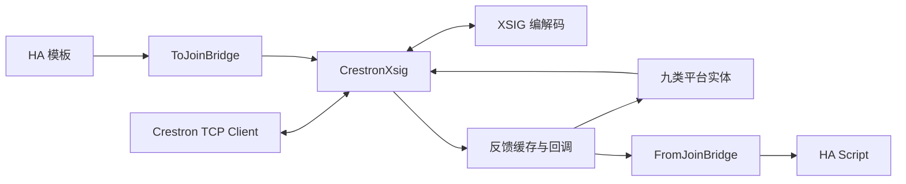

# 技术架构

本文面向 AI 协作者和后续开发者，描述当前代码行为与维护边界。使用说明见 [README.md](README.md)，未完成工作见 [TODO.md](TODO.md)。

## 1. 项目边界与目录

集成采用本地 TCP 推送，HA 作为服务端，Crestron 主控作为客户端。一个 YAML 域对应一个 config entry 和一个活动连接，九个平台共享 hub；不支持按主控配置多个独立实例。`manifest.json` 声明版本 `0.4.0`、`config_flow: true`、`iot_class: local_push`，没有额外运行时安装依赖。

```text
custom_components/crestron/
  __init__.py       YAML 装载、config entry 生命周期、重载、Hub 组合
  config_flow.py    单实例配置项、手动 to_joins 同步入口
  crestron.py       TCP、连接接管、反馈缓存、回调、写入与收发日志
  xsig_protocol.py  纯字节编解码和流式 FrameDecoder
  bridge.py         HA 模板 → join；join → HA Script
  entity.py         平台装载辅助函数和公共实体 mixin
  schema.py         join 编号、join key、整数值校验
  value_coercion.py 通用桥接值转换
  join_commands.py  瞬动、互斥选择、通用成对反馈
  join_registry.py  join 使用关系、冲突检测、日志元数据
  unique_ids.py     各平台唯一标识规则
  device.py         可选设备分组
  diagnostics.py   诊断入口
  light.py / switch.py / cover.py / climate.py
  number.py / select.py / sensor.py / binary_sensor.py / media_player.py
tools/
  xlsx_to_yaml.py   标准库 Excel 解析、校验、YAML 生成
  deploy_to_ha.sh   SSH 上传、HA 配置检查、重启
  update.sh        下载分支压缩包并覆盖当前目录
  git-pull.sh      稀疏拉取指定仓库目录的辅助脚本
tests/             unittest；HA 替身和本地 TCP 测试
sample.xlsx        四类设备示例
local/             被 Git 忽略的现场表格及生成配置
```

## 2. 分层与数据流



- `xsig_protocol.py` 不依赖 HA 或 socket；连接层负责向解码器喂字节及写回编码结果。
- `CrestronHub` 位于 `__init__.py`，组合 `CrestronXsig`、两个 bridge 和生命周期钩子。
- 实体持有底层 `CrestronXsig`，同步读取内存缓存，命令通过 `set_*` 下发。
- `schema.py` 直接引用协议范围常量，不依赖连接层。`whole_number()` 用 Decimal 拒绝布尔、小数部分非零和非有限值，供 number 和 climate 共享。

## 3. 配置装载与重载

`configuration.yaml` 的 `crestron:` 域包含必需 `port`、可选 `to_joins` / `from_joins` 及平台列表。YAML 保存于 `hass.data[DOMAIN][YAML_CONF]`，配置项本身不保存实体参数；config flow 通过固定域唯一标识防止重复实例。

启动时导入 YAML 创建 config entry；setup entry 建立 hub、启动监听、转发九个平台。`setup_platform_entities()` 对每条配置分别校验、构造；失败记录 ERROR 并跳过，同平台重复 unique_id 保留先出现的实体。设备关联只在 `device_id` 非空时创建。

`crestron.reload` 为管理员动作：读取 YAML、检查顶层及平台段结构、替换内存配置并重载配置项。失败后尝试用旧配置再次重载；如果恢复也失败，集成可能保持未运行状态。它不是文件回滚，不改磁盘上的 YAML。

必须区分三个校验层次：

| 层次 | 当前处理 |
|---|---|
| Excel 生成器检测到错误 | 整次生成终止，保留原输出文件 |
| YAML 域/平台段结构错误 | 可能拒绝装载或重载 |
| 单条平台实体无效或 unique_id 重复 | 记录错误，跳过该条，其他实体继续 |

启动对未知域内顶层键只告警，重载则拒绝；移除未知键后可以重载。join 使用冲突以警告提示，不自动改编号或阻止所有装载。UI 普通重载入口与明确重新读取 YAML 的 `crestron.reload` 不应混为一谈。

## 4. XSIG 编解码

| 类型 | 编码 | join 范围 | 值 |
|---|---|---|---|
| 数字 | 2 字节，`10vjjjjj 0jjjjjjj` | 1–4096 | v 为反相电平位 |
| 模拟 | 4 字节，`11vv0jjj 0jjjjjjj 0vvvvvvv 0vvvvvvv` | 1–1024 | 无符号 16 位整数 |
| 串行 | `11001jjj 0jjjjjjj`＋UTF-8＋`0xFF` | 1–1024 | 发送最大 252 字节正文 |

线上 join 从 0 编码，对外 API/YAML 从 1 编号。模拟 16 位值由首字节 2 位及末两字节各 7 位组成。模拟编码会夹到 `0–65535`，业务层应事先验证所需语义，不能依赖底层夹值掩盖非法输入。

FrameDecoder 处理 TCP 拆包、粘包，保留不完整尾部；错误 UTF-8 产生可记录事件并丢弃该帧。未知帧按当前解析规则消费。串行发送超长整帧丢弃，接收端不会按 252 字节拒绝已终止长帧；未终止缓冲超过 65536 字节会报错并结束连接。

控制字节与项目行为：

- HA 新连接发送 `0xFD` 请求同步。
- 主控发送 `0xFB` 时，HA 重新渲染并发送配置中的全部 `to_joins`。
- 不实现单根 join 查询，实体不轮询。

**不要把 `0xFD` 描述成完整数字/模拟/串行快照保证。** Crestron 旧版 Symbol Guide 对 Update Request 的描述是发送非零数字和模拟值、不发送串行值；当前现场 CP4N 程序是否另行补发零值、串行和设备状态，需要抓包验证。参考 [Crestron SIMPL Windows Symbol Guide，第 195 页](https://www.crestron.com/getmedia/39357ef1-4169-4e0f-82c3-d1f0958dcaa5/mg_sw-simpl_symbols_guide_1)。旧资料不直接证明当前现场实现。

## 5. 连接、缓存与可用性

连接时序：

1. `listen(port)` 在 `0.0.0.0` 等待 TCP Client。
2. 如已有 writer，新连接会替换旧连接；关闭等待有超时。
3. 写入 `0xFD` 并 drain，随即设 `available=True`。
4. connect callback 重置数字脚本边沿基线并同步 `to_joins`。
5. 进入 read / decode / 更新缓存 / 分发回调循环。
6. 断开时通知不可用；旧连接退出不能清除已接管的新 writer。

`available` 表示连接可用，不表示初始同步完成。`_digital/_analog/_serial` 只由成功解析的入站帧更新，出站命令不写入这些反馈缓存。`get_*` 可能返回默认零/空串；`has_*` 才表示是否收到过。

缓存不因重连清空；重载创建新 hub 后才重新开始。当前没有每 join 的连接代次或反馈时间戳，不能从有缓存推断当前会话已刷新。

命令直接 `writer.write()`，普通写入没有逐条 drain、确认或离线重放。`batched_writes()` 可以嵌套，在外层退出时统一写入；异常退出也会冲刷已收集数据。未连接时命令丢弃并记录日志。

同步统计在 INFO/DEBUG 启用，记录首帧延迟、帧数、不同 join 数、接收跨度及分发耗时。连续约一秒无新帧仅用于输出统计，不构成“状态已完整”的屏障。

## 6. 桥接与实体更新

### ToJoinBridge

模板优先级为显式 `value_template`、`entity_id`＋`attribute`、实体主状态。通过 HA 模板结果追踪器订阅变化。新连接、`0xFB` 或选项操作触发全部重发；全量同步逐条隔离模板异常。

`value_coercion.py` 为通用转换：数字识别约定的开关文本；模拟按 `int(float(value))` 后限制到协议范围；串行转文本。未知/不可用等无效状态跳过。这里不是 climate/number 的严格整数接口，也不自动将业务量缩放；非有限模拟输入的异常覆盖仍需改进。

### FromJoinBridge

每个 join 对应一个 HA Script，重复键最后一条生效并告警。数字脚本必须观测到严格字符串 `"0" → "1"`，首次值不触发；断线和每次连接接管均清空基线。没有时间防抖。初始低值若不补发，首个高值会被用作基线而跳过。

模拟和串行每帧触发，不做重复值过滤。脚本收到 `value` 变量，通过 HA 后台任务运行，异常隔离，读循环不等待动作结束。脚本任务没有集成层面的集中取消/并发策略，当前共用 Context；实际并发还受 HA Script 行为影响。

### CrestronEntity 与命令辅助函数

公共 mixin 放在平台实体基类之前，提供不轮询、连接可用性、订阅/退订。反馈写状态通过事件循环 `call_soon` 合并：同一批回调对同一实体只排一个待执行写；整个启动过程可能包含多批，因此不能承诺总共只写一次。移除后已排队写操作不会继续写状态。

`pulse_digital()`：在实体锁内置高、等待 0.2 秒、finally 置低。同一实体脉冲串行，不同实体可以并行；断线时 finally 不能保证低值送达硬件。`set_one_clear_others()` 先清除组内其他 join，再置目标为高；该选择信号保持高，不是瞬动。

`paired_feedback()` 供 switch、开关 light、cover 使用，接受一高一低的成对反馈；同高/同低返回不确定。它使用 `get_digital()`，尚无要求两根反馈都已上报的完整性判据。climate 使用自己的命令后反馈记录，避免旧电平参与新命令的确认。

## 7. 平台行为

| 平台 | 控制、反馈与状态策略 |
|---|---|
| 调光 light | 亮度 0–65535 ↔ 0–255；色温原值 K，2700–6500；不预先显示命令值；未收到亮度时目前显示关/0 |
| 开关 light | 保持电平或成对脉冲；反馈优先 state、switch、成对；支持预显示与历史恢复 |
| switch | 保持电平与脉冲二选一；反馈优先 mode_joins、state、switch、成对；模式组全部上报且全低才确认关闭 |
| cover | stop 必需，pos 或完整 open/close 至少一项；开关优先脉冲，否则写位置；真实位置优先于推定位置 |
| climate | 开关脉冲，模式/风速互斥保持电平；目标温度严格整数；历史恢复与命令预显示，后续按对应通道的新反馈校正 |
| number | min/max/step 为整数；写入/恢复限制范围，实时反馈原样接受，包括 0 |
| select | 非空选项组；先清后置；反馈首个高值生效，全低保留最近选择；支持恢复 |
| sensor | 模拟/divisor 或模式组二选一；未上报返回未知，模式组全已知且全低才显示关闭 |
| binary_sensor | 读取数字 join；未上报未知 |
| media_player | 静音数字量，音量按 65535 缩放，音源原值；0 为关机；显示依赖反馈 |

补充边界：

- 调光灯关机在已缓存亮度大于 0 时，先重发当前值、等待 0.2 秒再置零；新开灯命令通过序号使旧延迟关灯失效。
- 色温 join 必须配合亮度；不允许模拟灯光与数字开关控制混用。light 的 `type` 标签不替代 join 能力检查。
- cover 的 `current_cover_position` 优先真实位置，但 `is_closed` 另行优先独立关闭反馈、成对反馈，再参考位置；冲突时两属性可能不一致。
- number 的 step 是 UI 元数据，整数与范围校验不检查 `(value-min)` 必须为 step 的倍数；min/max 尚未受无符号 16 位边界约束。
- media_player 音源映射校验正整数、归一化编号冲突和重名，尚未限制编号最大 65535。

### 空调数值与反馈路径

空调固定使用摄氏度，目标步长 1、范围 16–30。`async_set_temperature()` 先调用共享整数校验并检查范围，通过后才更新目标值与发送模拟值；没有设温参数或没有 set_temp_join 时不操作。历史目标温度也经同一校验。

初次加入实体时，用 `has_analog/has_digital` 判定 hub 已有的反馈；目标温度反馈不按命令范围裁剪，真实 0 仍有效。运行期间按回调通道分开处理，温度事件不校正模式，风速事件不校正目标温度。室温仅在初始装载或自身通道事件中调用 `_reconcile_room_temp()`，差值至少 0.5°C 才接受。

climate 的 `_feedback_levels` 只记录本实体采用的数字反馈。开关、模式、风速命令下发前，分别清除对应组的旧记录，后续只纳入新收到的帧；不会改写共享 hub 的真实收包缓存。组内恰好一个高电平才有明确选项，全低或多个高时保留最近状态。未上报的成员不会阻止已收到的唯一高值生效，因此这仍不是全组同步完成屏障。

开关命令保留 2 秒保护期；到期定时器仅检查这次命令之后实际收到的开关电平，无需等温度或其他事件。无新反馈时保留预显示值。新开关命令会取消旧定时器并清除前次命令的反馈；断线清空本实体数字反馈记录并取消定时器，移除实体也取消定时器。重连可用性通知只更新可用性，不重新导入旧缓存；新上报状态仍正常采用。

`_command_lock` 是每台空调独有的锁，覆盖开关、模式、风速和设温的完整操作；模式命令的开机脉冲与后续模式写入在同一锁内完成。例如从关闭状态先请求制冷、随即请求制热，线上顺序为开机脉冲、制冷、制热，不再发生旧制冷延迟到新制热之后发送。关机及其他操作同样排队，不同空调仍并行；批量限速不属于这把锁的职责。脉冲取消时仍在 finally 释放电平；移除实体后，排队操作和未发送的后续模式命令丢弃。

模式/风速继续使用互斥保持电平，没有改成点动协议，也没有自动重发失败命令。新的矛盾反馈（例如制热后又收到明确制冷、设温后又收到不同目标温度）仍会反映到 HA，不能用预显示掩盖主控侧回退。climate DEBUG 日志记录带设备名的命令和字段反馈变化，用于与 XSIG 帧日志交叉核对。

## 8. 身份与设备分组

唯一标识集中在 `unique_ids.py`。已定规则不自动迁移；集成不读取、改写或清理 HA 实体注册表。修改显示名不会改变标识，修改用于身份的 join 会改变标识。

| 平台 | unique_id |
|---|---|
| 调光 light | `crestron_light_<brightness_join>` |
| 开关 light | `crestron_light_onoff_d<switch_join 或 on_join>` |
| switch | `crestron_switch_d<switch_join 或 on_join>` |
| cover | `crestron_cover_d<open_join>`，仅位置时为 `crestron_cover_<pos_join>` |
| climate | `crestron_climate_d<on_join>` |
| number | `crestron_number_<value_join>` |
| select | `crestron_select_<完整选项 join 升序以 _ 拼接>` |
| 数值 sensor | `crestron_sensor_<value_join>` |
| 模式 sensor | `crestron_sensor_mode_<完整模式 join 升序以 _ 拼接>` |
| binary_sensor | `crestron_binary_sensor_<is_on_join>` |
| media_player | `crestron_media_<source_number_join>` |

开关灯实现还保留 state_join 的防御性身份兜底，但正常配置必须有控制能力。旧 `entity.join_uid()` 已无生产调用，不应继续用于新增实体。

## 9. Excel 转换流程

`parse_xlsx()` 用 ZIP/XML 读取工作簿关系、共享字符串和 inline string。第一条工作表行作为表头，按单元格引用定位列；按 `<row r="…">` 保留真实行号。缺少可选 r 属性时使用前一行号加一，行数据保留内部 `_xlsx_row` 供诊断。

流程为：表头检查 → 模板/空行识别 → 单元格和能力组合校验 → 四类 builder → 名称去重及 join 检查 → 分平台 YAML 输出。编号列按范围验证，序号列不决定诊断行号；列名拼错、重复列名及缺少必需列有各自诊断。

builder 单独调用时可能返回 None；用户入口先汇总错误，存在任何错误便抛出 WorkbookValidationError，不创建目录/写目标文件。成功则覆盖全文件，输出默认 port 10200 和设备列表，不合并旧内容。`--check` 不写文件，通过返回 0，校验失败返回 1。

生成器只有四个设备 sheet，不生成其他五个平台或桥接脚本；特殊风速值列有意忽略。YAML 序列化器自行处理标量引用和转义，不依赖 PyYAML。PyYAML 可用于额外回读测试。

## 10. 诊断与运维

诊断顶层包含 `configured_entities`、`to_joins`、`from_joins`、`join_usage`、`xsig`。其中 `xsig` 包含 `available`、`connected`、脱敏 `peer`、`listening_port`、`cache_counts` 及三类缓存。串行值输出字符长度占位，数字/模拟值保留。配置计数不是实际注册实体计数。

`join_registry` 为读写关系生成元数据，发现重复写入、桥接冲突；只读镜像允许共享。帧日志独立使用 `custom_components.crestron.crestron.frames`，用于把原始 join 对应回实体/字段。

部署脚本先上传再检查 `ha core check`，检查通过才重启；没有远端文件事务和失败回滚。更新脚本按调用者工作目录覆盖文件，不清理旧文件，不重启。运行环境要求以目标 HA 版本为准；转换器的独立 Python 要求不能替代 HA Core 的 Python 要求。

## 验证方法

在仓库根目录：

```bash
python3 -m pip install -r requirements-test.txt
python3 -B -m unittest discover -s tests
python3 -B -m mypy --config-file mypy.ini --cache-dir=/dev/null
python3 -B tools/xlsx_to_yaml.py --check sample.xlsx
```

`requirements-test.txt` 提供 voluptuous 和 mypy；部分 YAML 回读测试在缺少 PyYAML 时跳过。mypy 只检查 value_coercion、xsig_protocol、join_commands、join_registry 四个无 HA 依赖模块。

测试使用最小 HA 替身，覆盖实体转换、边界、恢复、重载、桥接、编码及部分真实本地 TCP 场景。Excel 回归测试构造真实 ZIP/XML 工作簿，覆盖跳行、r 缺省回退、错误行号和失败时保留输出；空调回归覆盖真实零值、严格设温、历史恢复、跨字段旧缓存隔离、矛盾/乱序反馈、功率定时校正、连续命令次序、取消和移除，以及不同实体并发。

这些测试不能证明真实 HA 的完整实体生命周期、服务分发以及现场主控反馈协议正确。涉及这些边界的改动，需要补目标 HA 环境测试和现场收发验证。
